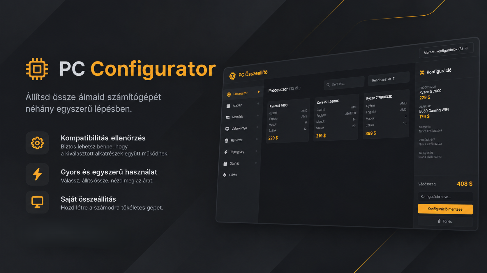

# PC Configurator fejlesztői dokumentáció

A dokumentáció a PC konfigurátor webalkalmazás felépítését és működését mutatja be.  
A dokumentáció célja, hogy a fejlesztők könnyen átlássák, melyik fájl milyen változókat, adatstruktúrákat és függvényeket tartalmaz, és hogyan indítható el a projekt.

## A projekt röviden

A webalkalmazás lehetővé teszi, hogy a felhasználó különböző PC-alkatrészekből (processzor, alaplap, memória, videokártya, tárhely, tápegység, ház, CPU hűtő) saját számítógépet állítson össze. Az alkalmazás közben:

- ellenőrzi az alkatrészek kompatibilitását,
- kiszámolja a konfiguráció végösszegét,
- lehetővé teszi a konfiguráció elmentését, későbbi betöltését és törlését.

## Navigálás
- js
  - [fetch.js](./js/fetch.js.md)
  - [main.js](./js/main.js.md)
  - [saved.js](./js/saved.js.md)
- adatok
  - [db.json és az API végpontok](./adatok/db.json.md)
- html
  - [index.html és savedConfigs.html](./html/html.md)
