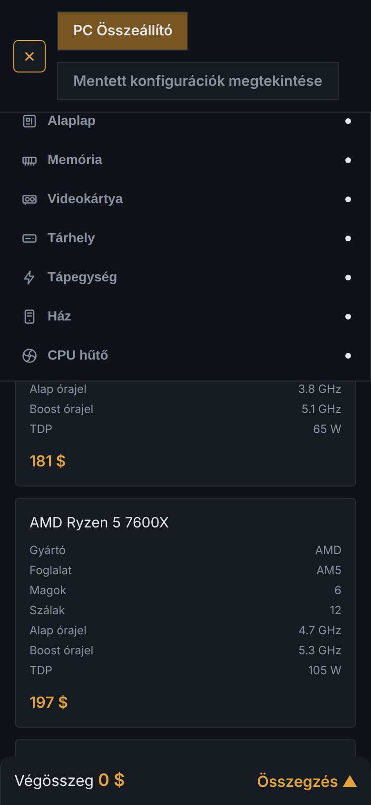
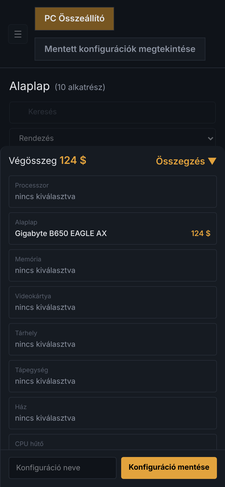

[Főoldal](./index.md)

# Telefonos használat és hibaelhárítás

## Telefonon és tableten

- **Menü (640 px alatt):** a bal felső **☰** gombbal nyílik, **✕**-szel vagy egy kategória kiválasztásával zárul.
- **Összegzés (960 px alatt):** az oldal alján egy sáv mutatja a végösszeget. Az **Összegzés ▲** gomb felnyitja a panelt (a mentés mezőjével együtt), az **Összegzés ▼** lezárja. Megnyitáskor a menü bezárul.

 

## Tipikus problémák

| Probléma | Ok és megoldás |
|----|----|
| Nem töltenek be az alkatrészek, vagy a mentett oldalon hibaüzenet áll | A szerver nem fut. Indítsd el a projekt `README.md`-je szerint, és frissítsd az oldalt. |
| A mentés gombja nem lesz **Mentve! ✓** | A mentés nem sikerült, valószínűleg szintén a szerver miatt. |
| Üres a kártyalista, `(0 alkatrész)` áll | A keresés nincs találat. A keresés csak a névben keres, töröld a mezőt. |
| Piros az alkatrész | Ütközés, cseréld ki az egyik érintett alkatrészt. |
| Eltűnt a konfigurációm | Oldalváltáskor a nem mentett kiválasztás elvész, mentsd el előtte. |
| Felülíródott egy mentés | Azonos nevet adtál meg. A felülírás nem vonható vissza. |
| Nem látom a menüt vagy az összegzést telefonon | Nyisd meg a **☰** gombbal, illetve az **Összegzés ▲** gombbal. |
