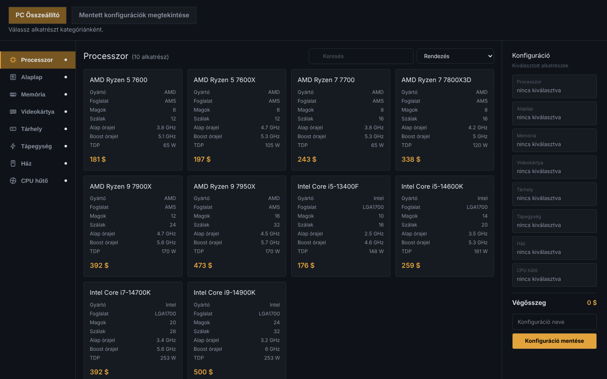

# PC Configurator felhasználói dokumentáció

Egy böngészőben futó alkalmazás, amellyel PC-alkatrészekből (processzor, alaplap, memória, videokártya, tárhely, tápegység, ház, CPU hűtő) saját számítógépet állíthatsz össze. Közben ellenőrzi az alkatrészek kompatibilitását, kiszámolja a végösszeget (dollárban), és elmentheted a konfigurációt. Regisztráció nem kell.

## Gyors útmutató

1. Válassz kategóriát a bal oldali menüben.
2. Kattints egy kártyára az alkatrész kiválasztásához.
3. Ismételd meg minden kategóriában, a jobb oldali panel mutatja a végösszeget.
4. Ha piros jelzést látsz, két alkatrész nem illik össze, cserélj ki egyet.
5. Írj nevet a konfigurációnak, és kattints a **Konfiguráció mentése** gombra.

## Navigálás
- [Az összeállító oldal](./osszeallito-oldal.md)
- [A mentett konfigurációk oldal](./mentett-konfiguraciok.md)
- [Telefonos használat és hibaelhárítás](./hibaelharitas.md)
