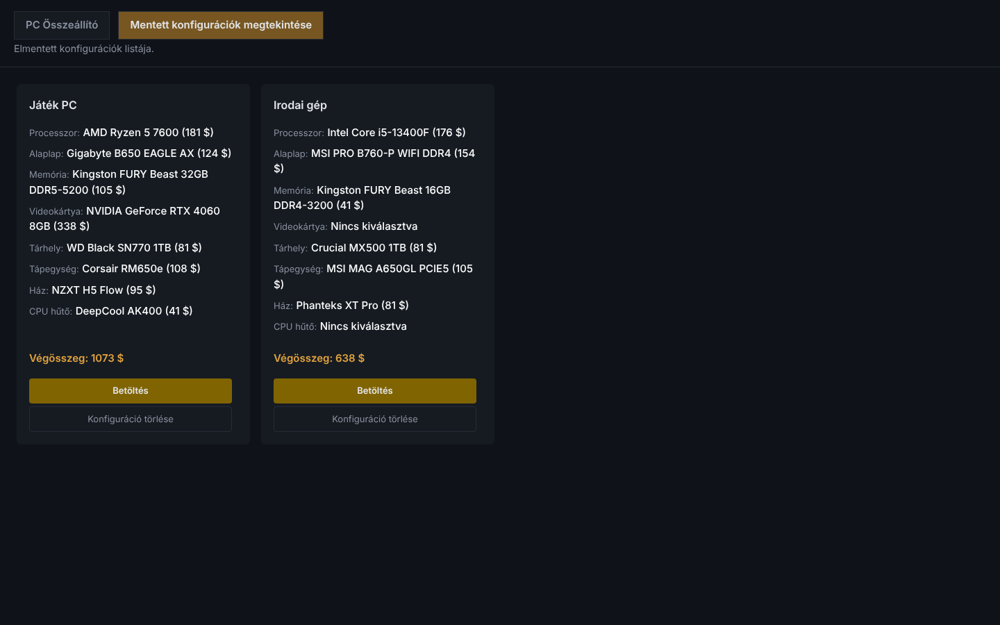
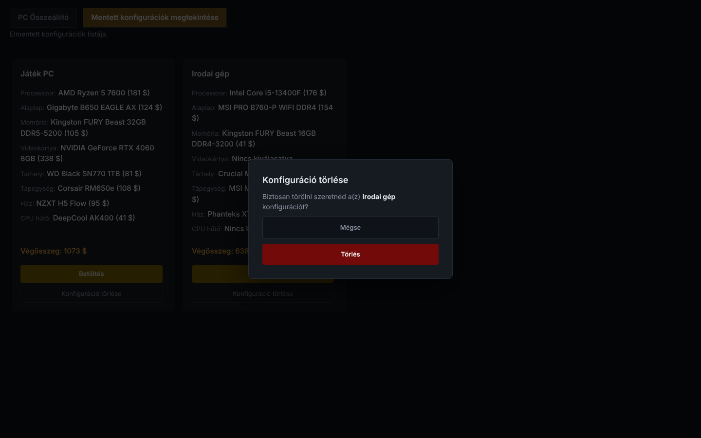

[Főoldal](./index.md)

# A mentett konfigurációk oldal

A fejlécben a **Mentett konfigurációk megtekintése** gombbal nyitható meg. Minden mentett konfigurációhoz egy kártya tartozik.

Egy kártyán látható a név, mind a nyolc kategória alkatrésze árral (`Nincs kiválasztva`, ha nincs), és a végösszeg.

## Betöltés

A **Betöltés** gomb megnyitja az összeállító oldalt: az alkatrészek ki vannak választva, a konfiguráció neve pedig a névmezőben áll. Módosításhoz cserélj alkatrészeket, írd be újra ugyanazt a nevet, és mentsd el, így a régi konfiguráció felülíródik. Más név esetén új konfiguráció keletkezik.

## Törlés

A **Konfiguráció törlése** gomb megerősítő ablakot nyit. A **Törlés** véglegesen törli a konfigurációt, a **Mégse** bezárja az ablakot.

> A törlés nem vonható vissza.

## Üzenetek

| Üzenet | Jelentése |
|----|----|
| `Nincsenek mentett konfigurációk.` | még nem mentettél, vagy mindent töröltél |
| `Hiba történt a konfigurációk betöltésekor.` | a szerver nem érhető el, lásd: [Hibaelhárítás](./hibaelharitas.md) |
