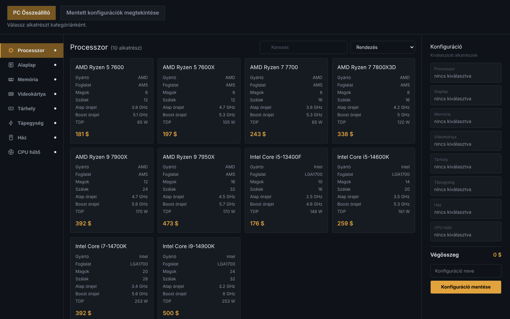
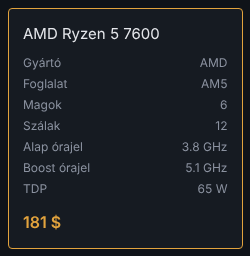
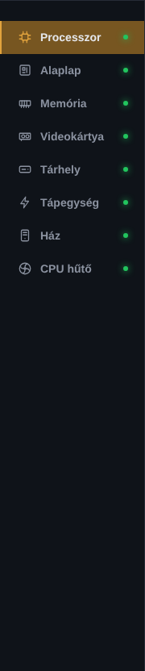
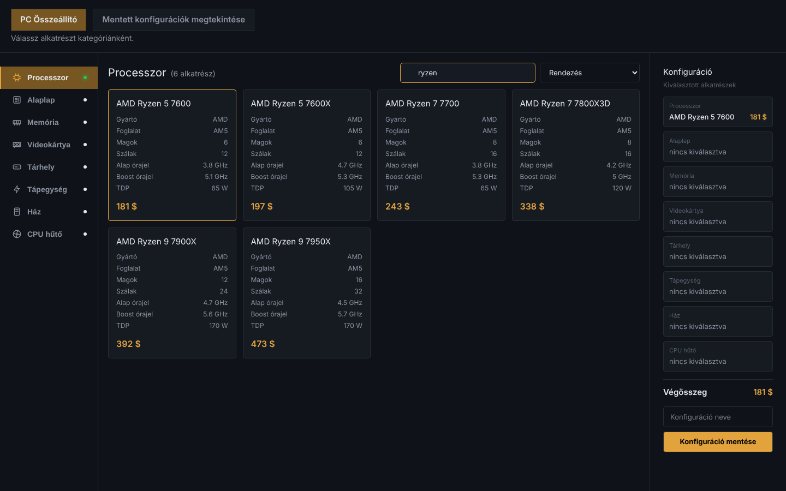
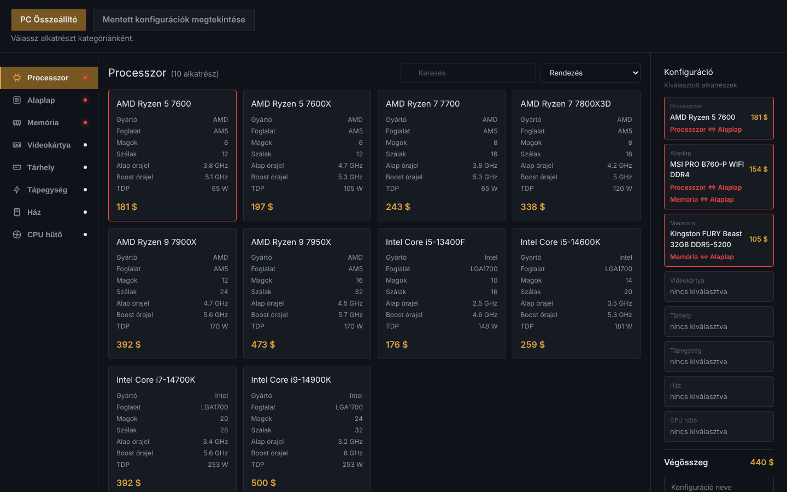
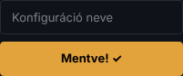

[Főoldal](./index.md)

# Az összeállító oldal

| Rész | Mire való |
|----|----|
| Fejléc | váltás az összeállító és a mentett konfigurációk oldal között |
| Kategóriamenü | váltás a nyolc kategória között |
| Keresés és rendezés | a kártyák szűrése és sorba rendezése |
| Kártyák | az aktuális kategória alkatrészei |
| Összegző panel | a kiválasztott alkatrészek és a végösszeg |
| Mentés | a konfiguráció elnevezése és mentése |

---

## Alkatrész kiválasztása

Kattints egy kártyára: a kártya **arany keretet** kap, az alkatrész megjelenik az összegző panelben.

- Visszavonás: kattints újra ugyanarra a kártyára.
- Csere: kattints egy másik kártyára, kategóriánként csak egy alkatrész választható.
- A kártyán az alkatrész neve, műszaki adatai és ára látható.

## Kategóriamenü

A gombok jobb szélén lévő pötty mutatja az állapotot:

| Pötty | Jelentése |
|----|----|
| fehér | még nincs kiválasztva alkatrész |
| zöld | van kiválasztott alkatrész, nincs ütközés |
| piros | van kiválasztott alkatrész, de ütközik egy másikkal |

## Keresés és rendezés

- **Keresés:** gépelés közben szűri a kártyákat az alkatrész **nevére** (kis- és nagybetűre nem érzékeny), pl. `ryzen`.
- **Rendezés:** alapsorrend, **Ár: alacsony → magas** vagy **Ár: magas → alacsony**.
- A kettő együtt is használható. Kategóriaváltáskor mindkettő alaphelyzetbe áll.

## Összegző panel

A jobb oldali panel kategóriánként egy sort mutat: a kiválasztott alkatrész nevét és árát, vagy `nincs kiválasztva` feliratot. Alul a **Végösszeg** látható, ami minden változtatásnál frissül.

## Kompatibilitás-ellenőrzés

Az alkalmazás automatikusan jelzi, ha két kiválasztott alkatrész nem illik össze:

| Ütközés | Mikor |
|----|----|
| Processzor <=> Alaplap | a foglalat nem egyezik (pl. AM5 és LGA1700) |
| Memória <=> Alaplap | a memória típusa nem egyezik (DDR4 és DDR5) |
| CPU hűtő <=> Processzor | a hűtő nem támogatja a processzor foglalatát |
| Ház <=> Alaplap | az alaplap formátuma nem fér a házba |
| Tárhely <=> Alaplap | az alaplap nem támogatja a tárhely csatlakozóját |
| Tápegység <=> Fogyasztás | a processzor és a videokártya TDP-je + 60 W több, mint a tápegység teljesítménye |

Ütközésnél a menü pöttye, a kiválasztott kártya kerete és az összegző panel érintett sora **piros** lesz, utóbbin az ütközés neve is megjelenik. A piros jelzés eltűnik, ha az egyik ütköző alkatrészt kicseréled.

*Ryzen (AM5) processzor, LGA1700 foglalatú DDR4-es alaplap és DDR5 memória együtt.*

> Az ütközés csak figyelmeztetés, a konfiguráció ettől még menthető.

## Mentés

Írj nevet a panel alján a **Konfiguráció neve** mezőbe, és kattints a **Konfiguráció mentése** gombra. A gomb két másodpercre **Mentve! ✓** lesz.

- Név nélkül a mentés neve **Névtelen konfiguráció** lesz.
- Ha már van azonos nevű konfiguráció, az új mentés **felülírja** azt.
- Mentés után a névmező kiürül, a kiválasztott alkatrészek megmaradnak.
